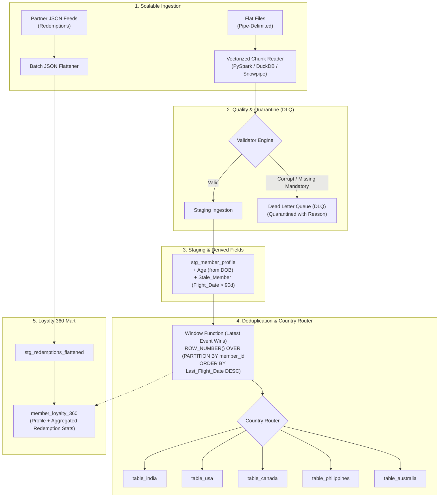

# SkyPoints Global Airline Loyalty Data Pipeline

[]()
[]()
[]()

> **Incubyte Data Craftsperson Assessment Solution**  
> Designed, built, and verified following Software Craftsmanship, Test-Driven Development (TDD), and billion-record scalable engineering practices.

---

## 1. System Architecture & High-Scale Design

The pipeline ingests millions to billions of daily records across two primary feeds:
1. **Member Profile Data**: Pipe-delimited flat file (`|H|` Header, `|D|` Detail records).
2. **Partner Redemption Transactions**: Semi-structured nested JSON feeds.



---

## 2. Answers to Assessment Deliverables

### Deliverable 1: DDL Queries
Production Snowflake DDLs and local DuckDB schemas are implemented in:
- [`sql/snowflake/ddl.sql`](sql/snowflake/ddl.sql):
  - `RAW_MEMBER_LANDING`: Raw VARCHAR landing table ensuring 100% ingestion reliability.
  - `STG_MEMBER_PROFILE`: Strongly typed staging schema clustered on `(COUNTRY, ENROLLMENT_DATE)`.
  - `TABLE_INDIA`, `TABLE_USA`, `TABLE_CAN`, etc.: Country target tables clustered on `MEMBER_ID`.
  - `RAW_REDEMPTIONS_LANDING`: Semi-structured VARIANT landing table.
  - `STG_REDEMPTIONS_FLATTENED`: Flattened relational transactions table.
  - `MEMBER_LOYALTY_360`: Analytical dimension and fact mart.

### Deliverable 2: Staging Load with Derived Columns (`Age` & `Stale_Member`)
- **`Age`**: Computed dynamically from `DOB` using exact calendar differences (accounting for leap years and month/day progression). Handles 7-digit dropped leading zeros (`3051985` $\rightarrow$ `03051985`).
- **`Stale_Member`**: Computed as `'Y'` when `DATEDIFF(day, Last_Flight_Date, CURRENT_DATE) > 90` or when `Last_Flight_Date` is NULL; otherwise `'N'`.
- Code: [`src/staging.py`](src/staging.py) | SQL: [`sql/snowflake/transformations.sql`](sql/snowflake/transformations.sql)

### Deliverable 3: Country Split & "Latest Record Wins" Rule
- When members move countries, historical records may have older country designations.
- **Resolution**:
  ```sql
  ROW_NUMBER() OVER (
      PARTITION BY member_id 
      ORDER BY COALESCE(last_flight_date, enrollment_date) DESC, ingested_at DESC
  ) AS rn
  ```
- Only `rn = 1` survives. If a member moved from India to USA, they are cleanly removed from `table_india` and inserted into `table_usa`.
- Code: [`src/country_router.py`](src/country_router.py)

### Deliverable 4: Semi-Structured JSON Redemption Feed & 360 Join
- The nested JSON array of redemptions is parsed and unnested into `stg_redemptions_flattened` (or using Snowflake `LATERAL FLATTEN(input => payload:redemptions)`).
- Joined back to member profile data to produce `member_loyalty_360`:
  - `total_redemptions`: Total count of redemption transactions.
  - `total_miles_redeemed`: Sum of miles redeemed.
  - `last_redemption_date`: Most recent redemption activity.
  - `top_partner`: Member's most frequently used partner airline.
- Code: [`src/redemptions.py`](src/redemptions.py)

### Deliverable 5: Data Validations & Dead Letter Queue (DLQ)
Catches dirty data issues visible across the assessment brief and sample datasets:
- **Mandatory Field Checks**: Null checks for `Member_Name`, `Member_Id`, `Enrollment_Date`.
- **Date Sanitation**: Handles invalid calendar dates (such as month `13` in `2021-13-13`), text strings `'NULL'`, and dropped leading zeros.
- **Dead Letter Queue (DLQ)**: Invalid records are quarantined into a dedicated structure with explicit `error_reason` and timestamps without halting the batch.
- Code: [`src/validators.py`](src/validators.py)

### Deliverable 6: Live Demonstration
The repository includes a ready-to-run live demonstration CLI script:
```bash
python -m src.main
```

---

## 3. Billion-Record Scale Engineering Considerations

| Challenge | Solution at Billions Scale |
| :--- | :--- |
| **Data Ingestion Bottleneck** | Auto-ingest via Snowflake Snowpipe or distributed PySpark chunked readers. Raw landing tables store unparsed strings to avoid load aborts. |
| **Partitioning Strategy** | Target tables partitioned by `Country` and clustered by `Member_Id`. Prunes 95%+ of partition scans during country-specific queries. |
| **Deduplication at Scale** | Micro-batch deduping using partition pruning on `ingestion_date` and hash-based distributed joins. |
| **Fault Tolerance & DLQ** | Non-blocking quarantine pattern (DLQ). Malformed rows never crash daily ingestion; alerted via metrics. |
| **Idempotency** | Target tables populated via deterministic `MERGE INTO` operations, making pipelines safely rerunnable. |

---

## 4. Quickstart: Running Tests & Demonstration

### Prerequisites
- Python 3.10+
- Dependencies: `pip install duckdb pytest pandas`

### 1. Run Comprehensive Test Suite (TDD)
```bash
python -m pytest tests/ -v
```
All 31+ unit and integration tests validate parsing, derivations, country routing, JSON flattening, and full pipeline execution.

### 2. Run the Live Demonstration Pipeline
```bash
python -m src.main
```
Outputs live formatted tables showing ingestion metrics, DLQ quarantine items, country target tables, and the Member Loyalty 360 mart view.

---

## 5. Repository Structure
```text
incubyte-data-craftsperson-assessment/
├── data/
│   ├── sample_member_profile.dat   # Pipe-delimited flat file feed (|H| and |D|)
│   ├── sample_redemptions.json     # Partner airline JSON redemption feed
│   ├── AUS.csv / AUS.xlsx          # Country sample datasets
│   ├── USA.csv                     # Country sample datasets
│   ├── IND.csv                     # Country sample datasets
│   └── DE_Assessment_file.pdf      # Original assessment specification
├── sql/
│   └── snowflake/
│       ├── ddl.sql                 # Production Snowflake table DDLs
│       └── transformations.sql     # Staging derivations & country split SQL
├── src/
│   ├── models.py                   # Dataclasses & schema models
│   ├── validators.py               # Validation rules & DLQ routing
│   ├── flat_file_reader.py         # Pipe-delimited & CSV feed parser
│   ├── staging.py                  # Staging engine (Age & Stale Member)
│   ├── country_router.py           # Country routing & latest record wins
│   ├── redemptions.py              # JSON redemption flattener & 360 mart
│   ├── pipeline.py                 # End-to-end orchestrator
│   └── main.py                     # CLI & live demonstration runner
└── tests/
    ├── test_validation.py          # TDD tests for validation rules & DLQ
    ├── test_staging.py             # TDD tests for Age & Stale Member
    ├── test_country_split.py       # TDD tests for country routing
    ├── test_redemptions.py         # TDD tests for JSON parsing & joins
    └── test_pipeline.py            # End-to-end integration tests
```
