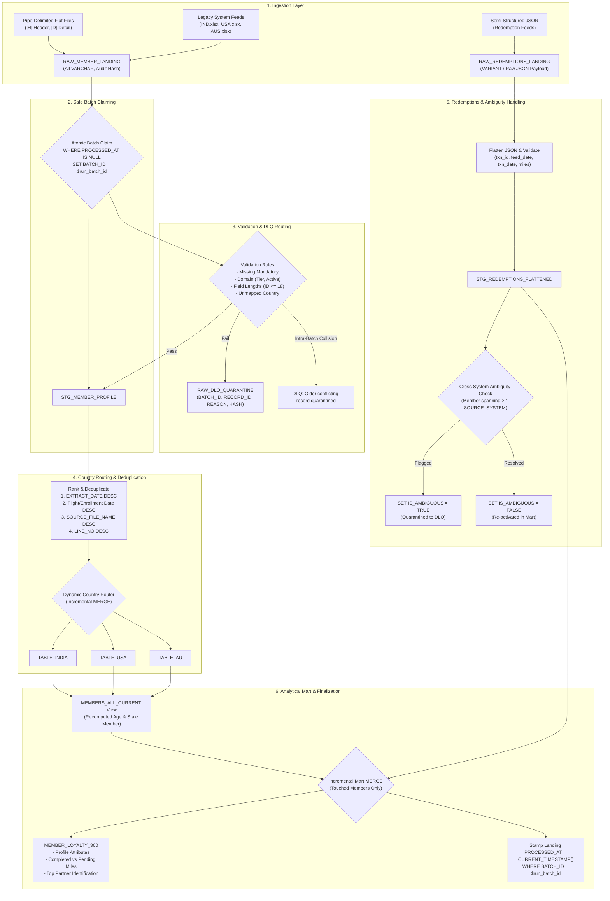

# SkyPoints Pipeline Architecture & High-Scale Design

This document details the architectural blueprint, data flow, scale considerations, and deduplication/quarantine mechanics of the SkyPoints Global Airline Loyalty Data Pipeline.

---

## 1. End-to-End Architectural Blueprint

---

## 2. Pipeline Stages & Execution Lifecycle

### Layer 1: Raw Landing
- Ingests raw data as text (`VARCHAR`) or `VARIANT` to guarantee zero load dropouts.
- Captures ingestion metadata: `SOURCE_SYSTEM`, `SOURCE_FILE_NAME`, `LINE_NO`, `EXTRACT_DATE`, and `RAW_RECORD_HASH` (`SHA2_HEX`).
- **Atomic Batch Claiming**: When a pipeline run begins, it claims unclaimed landing records (`WHERE PROCESSED_AT IS NULL`) by stamping `BATCH_ID = $run_batch_id`. If a run fails mid-flight, interrupted rows can be reclaimed without data loss.

### Layer 2: Validation & Dead-Letter Queue (DLQ)
- Enforces strict constraints: mandatory fields (`member_name`, `member_id`, `enrollment_date`), domain boundaries (`tier_code` in `PLT, GLD, SLV`, `is_active` in `A, I`), field length limits, and calendar date ranges (handling dropped leading zeroes and US date hints).
- **Intra-batch Collision Quarantine**: Conflicting records within the same batch sharing `(source_system, member_id)` with different names are ranked. The older record is quarantined to DLQ (`Key collision: superseded by newer record`), while the newest record proceeds.
- **Cross-batch Renames**: Treated as standard updates. Newer records update existing country table records without sending legitimate historical names to DLQ.

### Layer 3: Staging & Country Split
- Clean records are staged into `STG_MEMBER_PROFILE` where derived fields (`age`, `stale_member`) are computed.
- Members are routed to country-specific core tables (`TABLE_INDIA`, `TABLE_USA`, `TABLE_CAN`, `TABLE_PHIL`, `TABLE_AU`) based on canonical country mappings.
- **Country Migration Mechanics**: When a member relocates from one country to another with a newer `EXTRACT_DATE`, an incremental MERGE inserts the record into the new country table and removes them from the previous country table, preventing duplicate identities across regions.

### Layer 4: Redemptions & Ambiguity Resolution
- Semi-structured JSON feeds are parsed and flattened into `STG_REDEMPTIONS_FLATTENED`.
- Strict validation preserves original transaction attributes without synthetic data invention. Missing transaction dates or negative redemption amounts are quarantined into DLQ.
- **Non-Destructive Ambiguity Flagging**: If a `member_id` appears across multiple distinct source systems, redemptions are flagged with `IS_AMBIGUOUS = TRUE` and quarantined to DLQ. Crucially, redemptions are **never deleted**. When subsequent batches resolve the ambiguity, `IS_AMBIGUOUS` is reset to `FALSE`, allowing transactions to seamlessly flow back into analytical aggregates.

### Layer 5: Analytical Mart (`MEMBER_LOYALTY_360`)
- Built from `MEMBERS_ALL_CURRENT`, dynamically recalculating `age` and `stale_member` against current reference dates.
- Aggregates redemptions strictly separating **COMPLETED** miles from **PENDING** miles.
- Determines the member's `top_partner` based on transaction frequency with alphabetical tie-breaking.
- Incremental merge updates only touched members (members present in the current batch or members whose redemptions/ambiguity status changed), avoiding expensive full-table scans.

---

## 3. High-Scale Design Considerations

| Engineering Dimension | Snowflake Implementation | Local Python / DuckDB Implementation |
| :--- | :--- | :--- |
| **Ingestion Scaling** | Snowpipe auto-ingest over cloud object storage stages with `ON_ERROR = 'CONTINUE'` | Chunked file streaming with `openpyxl` data-only streaming and chunked CSV processing |
| **Deduplication** | Vectorized window functions (`ROW_NUMBER() OVER (...)`) over distributed micro-partitions | In-memory vectorized DuckDB execution with deterministic multi-key sorting |
| **Idempotency** | Session-scoped `$run_batch_id`, transactional MERGE statements, and landing state machines | In-memory state tracking with primary-key collision management (`INSERT OR REPLACE`) |
| **Clustering & Pruning**| Natural micro-partition pruning on `(SOURCE_SYSTEM, EXTRACT_DATE)` | DuckDB columnar block compression |
| **Schema Evolution** | Declarative DDL with `ADD COLUMN IF NOT EXISTS` upgrade migrations | Typed dataclass models with optional default fields |
